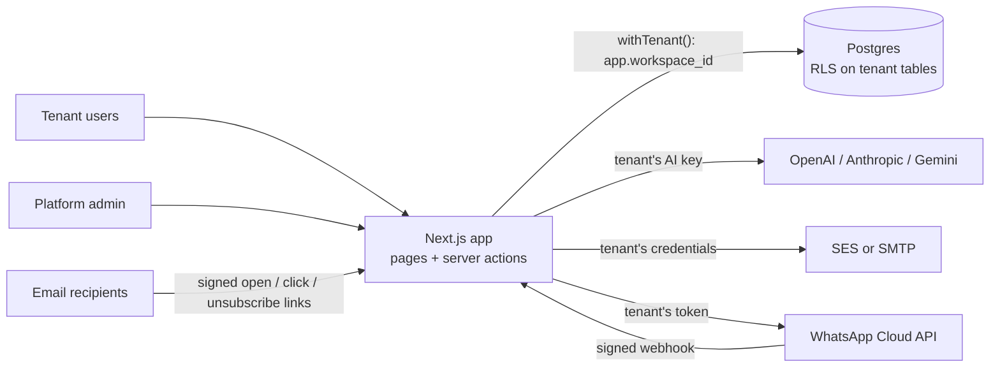

# Pollen

Email and WhatsApp marketing for small businesses, with AI that writes in each business's own voice. One multi-tenant app; every business brings its own AI and email provider keys.

## The problem

Small businesses like cafés, salons and small online brands have customer lists, but rarely the time or a copywriter to send regular campaigns. Most email tools give them a blank editor. Generic AI text does not sound like them, and nothing checks it before it goes out. Pollen learns how the business talks, drafts campaigns in that voice, checks them against a quality bar, and sends them to the right subset of customers.

## Features

### Email campaigns

- Block editor (heading, paragraph, bullet list, button, divider) with a live preview. The preview uses the same renderer as the sent email.
- AI compose. You give a goal, a brief, a link and a length. The model returns three subject lines, preview text and the body.
- Quality gate. A second model call scores the draft from 1 to 10 on clarity, voice match, relevance, call to action and skimmability. Rule checks run alongside: subject length, spam phrases, button links, unknown merge tags and a missing postal address. If the average is below 8 or a rule fails, one revision pass runs, and the higher-scoring version is kept.
- Quick rewrites: shorter, friendlier, punchier, more professional, Hindi, Hinglish.
- Score a hand-edited email without rewriting it.
- Merge tags with fallbacks, for example `{{first_name|there}}` and `{{attr.city}}`.
- Test send, then send to all subscribers, a list or a segment. A campaign is claimed atomically before sending, so a double click cannot send it twice.
- Signed open pixel, click redirect and unsubscribe links. Emails carry the RFC 8058 one-click `List-Unsubscribe` header. People who click the footer link get a confirmation page, so link scanners cannot unsubscribe them.
- Report per campaign: delivered, opened, clicked, click-to-open, unsubscribed and top links.
- Sending is blocked until the brand kit has a postal address, because anti-spam laws require one.

### Contacts, lists and segments

- Add contacts by hand or import a CSV (up to 20,000 rows or 5 MB). Common header names are recognised, and unknown columns become custom fields. Re-imports merge tags and fill empty fields. They never re-subscribe someone who unsubscribed.
- Static lists.
- Segment rule builder over status, tag, source, email domain, custom field, list membership, join date, last engagement, and opened or clicked in the last N days. Rules compile to parameterised SQL.
- AI segment builder. A plain-English request becomes rule JSON, never SQL. The rules are validated against the workspace's real lists; if validation fails, the errors go back to the model once. The preview shows the match count and a sample of contacts.

### Brand kit

- Logo, colours, website, postal address and footer text.
- Brand voice extraction from the business website, pasted writing samples, or both. The result is a structured voice guide (tone, do and don't lists, preferred and banned words, sample phrases). Every writing prompt includes it: compose, review, rewrite and WhatsApp replies.

### WhatsApp (Meta Cloud API)

- Each workspace connects its own WhatsApp Business number. Pollen checks the token against the Graph API before saving it.
- A webhook per workspace. GET requests do Meta's verify-token handshake. POST requests are checked with HMAC-SHA256 when the workspace has saved its app secret. Inbound messages and delivery and read receipts are stored, and duplicate deliveries are ignored.
- Inbox that enforces WhatsApp's 24-hour reply window, with AI-drafted reply suggestions.
- Auto-reply: off, a fixed away message, or an AI reply in the brand voice.
- Template broadcasts to all contacts, a list or a segment, using the workspace's approved templates. Template variables map to merge fields or fixed text.

### Workspaces and admin

- Workspace home: 30-day stats, an opens and clicks chart, and a setup checklist.
- Roles: owner, admin, member. Only owners and admins can change AI keys, email senders, WhatsApp settings, brand kit details and the team.
- Platform admin console at `/admin`. It lists tenants with usage (contacts, emails sent, AI calls and tokens). Admins can create a tenant and its owner with a one-time password, change the plan, suspend a tenant, read the audit log, and open any workspace (a banner shows when they do).
- A demo flag on a workspace disables email campaigns and WhatsApp broadcasts.

### Bring your own keys (BYOK)

- AI: OpenAI, Anthropic or Google Gemini. Each workspace sets a "quality" and a "fast" model name. The key is tested before it is saved.
- If a workspace has more than one AI provider, a failed call moves on to the next one, unless the request itself was invalid. Every attempt is logged with tokens, latency, errors and quality score.
- Email: AWS SES (v2 API) or any SMTP server. SMTP logins are verified when saved.

## Architecture



### Multi-tenancy with row-level security

- Every tenant-owned table has a `workspace_id` column and a policy: `workspace_id = app_ws() or app_is_admin()`. Row-level security is forced on these tables (`db/migrations/`).
- The app connects as `pollen_app`, a role created with `NOBYPASSRLS`. Only `scripts/db.mjs` (migrate and seed) uses the owner connection.
- `withTenant(workspaceId, fn)` in `lib/db.ts` opens a transaction and calls `set_config('app.workspace_id', id, true)`. The setting is transaction-local, so a pooled connection cannot carry one tenant's context into the next request. This is also why the app can use Supabase's transaction pooler.
- A query that forgets its `WHERE workspace_id = …` still sees only one tenant's rows. `workspace_id` defaults to `app_ws()`, so inserts cannot forget it either.
- `withGlobal()` covers platform tables (users, workspaces, memberships, audit log). `withAdmin()` sets `app.platform_admin` for the admin console.
- Supabase's `anon` and `authenticated` roles get no grants, so Supabase's auto-generated REST API exposes no data.
- Every tenant page and server action first calls `requireWorkspace(slug)` (`lib/auth.ts`). It checks membership and role, and sends suspended workspaces to a notice page.

### Sealed secrets

- Tenant API keys, SES or SMTP credentials and WhatsApp tokens are encrypted in the app before they reach the database (`lib/crypto.ts`).
- AES-256-GCM, a random 12-byte IV per value, stored as `v1.<iv>.<tag>.<ciphertext>`. The key is `ENCRYPTION_KEY` (32 bytes, base64) and lives only in the environment.
- For AI keys, only the last 4 characters are stored in clear text, for display.
- Tracking and unsubscribe links carry an HMAC-SHA256-signed payload with the workspace, campaign and contact IDs. The public routes trust nothing else in the URL. The click destination is inside the signed payload, so the redirect cannot be abused as an open redirect.

### AI layer

- One entry point, `runObject()` in `lib/ai/core.ts`. It builds the model from the tenant's decrypted key, asks for structured output validated by a Zod schema, retries transient errors, and times out after 90 seconds. It falls over to the next provider and writes every attempt to `ai_runs`.
- Email bodies are flat JSON blocks, not HTML. The renderer escapes all text and builds table-based, inline-styled HTML, so model output cannot inject markup or break the layout.
- Segment rules come from a closed vocabulary (`lib/segments.ts`), so a model cannot widen access or write raw SQL.
- The website fetcher for brand voice refuses private and internal IP addresses. It times out after 12 seconds and parses at most the first 1.5 MB of HTML.

## Tech stack

- Next.js 16 (App Router, server components, server actions), React 19, TypeScript
- Tailwind CSS 4 and shadcn/ui (Radix UI), Recharts
- PostgreSQL on Supabase, accessed with `pg` (node-postgres) and plain SQL; no ORM
- NextAuth 4 with email and password (bcrypt) and JWT sessions
- Vercel AI SDK 7 with the OpenAI, Anthropic and Google providers; Zod for schemas
- Nodemailer with AWS SES v2 or SMTP
- WhatsApp Business Cloud API (Graph API) called with `fetch`
- Cheerio for reading website text
- Configured for Vercel (`vercel.json` pins the Mumbai region, `bom1`)

## Getting started

### Prerequisites

- Node.js 20.9 or later
- A Supabase project. Plain PostgreSQL also works if you first create empty `anon` and `authenticated` roles, which the migration revokes access from.
- To use the features: an API key from OpenAI, Anthropic or Google; an SMTP server or an AWS SES account with a verified sender; optionally a Meta developer app with WhatsApp.

### 1. Install

```bash
npm install
cp .env.example .env.local
```

### 2. Set up Supabase

1. Create a project and note the database password.
2. Open **Connect** in the Supabase dashboard.
3. Copy the **direct connection** string (or the **session pooler** string if you need IPv4) into `DATABASE_ADMIN_URL`.
4. Copy the **transaction pooler** string (port 6543) into `DATABASE_URL`. Change the user from `postgres.<project-ref>` to `pollen_app.<project-ref>`, and change the password to the one you put in `POLLEN_APP_PASSWORD`.

### 3. Environment variables

| Variable | Required | What it is and where to get it |
| --- | --- | --- |
| `DATABASE_ADMIN_URL` | For migrate and seed | Owner connection string from Supabase **Connect**. The app itself never uses it. |
| `DATABASE_URL` | Yes | Transaction pooler string with the `pollen_app` user (see step 2). |
| `POLLEN_APP_PASSWORD` | For migrate | Any strong password you choose. `migrate` sets it on the `pollen_app` role. |
| `ENCRYPTION_KEY` | Yes | Run `openssl rand -base64 32`. If you change it later, stored keys can no longer be decrypted. |
| `NEXTAUTH_SECRET` | Yes | Run `openssl rand -base64 32`. |
| `NEXTAUTH_URL` | Yes | The app's base URL, for example `http://localhost:3000`. |
| `APP_URL` | No | Public HTTPS URL for links in emails and for the WhatsApp webhook. If empty, the request host is used. |
| `SEED_ADMIN_EMAIL` | For seed | Login email for the platform admin the seed creates. |
| `SEED_ADMIN_PASSWORD` | For seed | Password for that admin. |
| `SEED_DEMO_PASSWORD` | For seed | Password for the demo owner, `owner@bloombrew.example`. |

AI keys, email senders and WhatsApp credentials are not environment variables. Each workspace adds its own in the app, and they are stored encrypted.

### 4. Migrate and seed

```bash
node --env-file=.env.local scripts/db.mjs migrate
node --env-file=.env.local scripts/db.mjs seed
```

`migrate` applies `db/migrations/*.sql` in order and records them in `schema_migrations`. It creates the tables, the `pollen_app` role and the RLS policies, then sets the role's password.

`seed` creates the platform admin and a demo tenant, "Bloom & Brew Café" (`/w/bloom-brew`), with:

- 64 fictional contacts on `example.com` addresses
- two lists and two segments
- one sent campaign with sample engagement data, and one draft
- three sample WhatsApp threads

Running `seed` again replaces the demo tenant. (`npm run db:migrate` and `npm run db:seed` also exist, but they do not load `.env.local`.)

### 5. Run

```bash
npm run dev        # http://localhost:3000
npm run typecheck
npm run build && npm start
```

Sign in with `SEED_ADMIN_EMAIL` to reach `/admin`, or as `owner@bloombrew.example` to reach the demo workspace. In a real workspace, open **Settings** to add an AI key and an email sender. Then add the business address under **Brand kit** before sending.

### 6. Connect WhatsApp (optional)

There is no separate WhatsApp server. Pollen calls Meta's Cloud API and receives Meta's webhooks on its own routes.

1. In a Meta developer app with the WhatsApp product, get the phone number ID, the WhatsApp Business Account (WABA) ID, a permanent system-user access token, and the app secret.
2. Paste them on the workspace's **WhatsApp** page. Pollen verifies the token and shows a callback URL (`/api/wa/webhook/<workspace-id>`) and a verify token.
3. In Meta, go to **WhatsApp → Configuration**. Paste both values and subscribe to the `messages` field.

Meta must be able to reach the callback URL. For local testing, expose the dev server through an HTTPS tunnel and set `APP_URL` to the tunnel's address.

## Project structure

```
app/
  admin/                 platform console: tenants, usage, audit log
  w/[slug]/              tenant workspace: home, campaigns, whatsapp, contacts,
                         lists, segments, brand kit, settings
  api/auth/              NextAuth (email + password)
  api/t/o, api/t/c       signed open pixel and click redirect
  api/u, u/[token]       one-click unsubscribe and confirmation page
  api/wa/webhook/        per-workspace WhatsApp webhook
  login/, suspended/
components/pollen/       app shell, logo, shared UI pieces
components/ui/           shadcn/ui components
db/migrations/           schema, roles and RLS policies (plain SQL)
lib/
  db.ts                  connection pool, withTenant / withGlobal / withAdmin
  auth.ts                NextAuth config, requireWorkspace, roles
  crypto.ts              AES-256-GCM seal/unseal, signed link tokens
  tenant.ts              brand kit loading, audience → SQL, base URL
  segments.ts            segment rule schema, validation, SQL compiler
  tracking.ts            open / click / unsubscribe events
  ai/                    providers, runObject (failover + metering), features,
                         rule checks, website fetcher
  email/                 blocks, HTML renderer, SES/SMTP transport, campaign send
  whatsapp/              Graph API client, webhook processing, auto-reply
  actions/               server actions per area
scripts/db.mjs           migrate and seed
```

## Status and limitations

This is an early version (0.1). Several parts that a production email tool needs are not built yet.

- **Sending runs inside the request.** One send reaches at most 2,000 email recipients (5 at a time) or 1,000 WhatsApp recipients. There is no background queue, no scheduled sending, and no automatic retry of failed recipients after the send. Large sends can hit serverless time limits.
- **No bounce or complaint handling.** SES and SMTP bounce notifications are not ingested. The schema has `bounced` and `complained` statuses, but nothing in the app sets them (only the demo seed uses `bounced`).
- **Open tracking is approximate.** Image blocking and mail privacy features distort open counts. A click also counts as an open.
- **Accounts are created for users.** There is no self-serve sign-up, no password reset and no way to change a password in the app. New users get a one-time password from a platform admin, or from a workspace owner or admin. There is no rate limiting on login.
- **Plans are labels only.** No limits or billing are enforced.
- **The WhatsApp signature check is optional.** It runs only if the workspace saved its app secret (the form recommends it). Inbound media messages appear only as placeholders such as `[image message]`. Pollen cannot send media. Numbers are connected by pasting credentials; Meta's Embedded Signup is not built.
- **The website fetcher checks only the first address.** It refuses private IPs for the initial hostname but follows redirects without checking them again.
- **AI quality scores are the model's own judgement.** They depend on the model each tenant configures. The default model names in `lib/ai/providers.ts` are starting points and can be changed per workspace.
- **No automated tests or lint setup.** `npm run typecheck` is the only check.

Not built yet: a background send queue and scheduling, automations and drip sequences, a light CRM (pipeline stages and a per-contact timeline), billing, and WhatsApp Embedded Signup.
